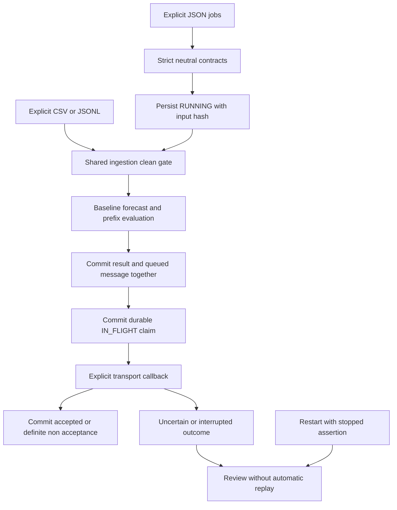

# Application structure and decisions

`data_services.components` consolidates the public ingestion, evaluator and outbox
models. The evaluator's sole import adaptation is relative ingestion import, so
all components share the same `Batch` and `Point` classes. Public algorithms are
otherwise preserved. `contracts` owns new neutral job configuration; `state`
validates data-only snapshots; `journal` owns immutable commits and exclusive
sessions; `service` owns workflow/queue transitions. `files` supplies the source
boundary to unchanged public guarded-I/O snapshots. `cli` performs explicit local
operations; `packaging` selects verified source without runtime material.

## Why the system is structured this way

1. **Keep original business context outside the package.** These are new neutral
   jobs and record shapes. No historical source reader, schema, mapping, formula,
   scheduler policy, recipient or deployment configuration is adapted into them.
2. **Persist intent before work.** A run begins as `RUNNING`; a transport attempt
   becomes `IN_FLIGHT` before caller code executes. A crash leaves a visible
   unfinished intent. Recovery holds it for review, without pretending to know
   whether an external effect happened.
3. **Publish results and queued intent together.** A completed run and its
   notification share one committed snapshot. There is no intermediate accepted
   state containing only one of those records.
4. **Use immutable commits instead of in-place rewriting.** Each generation has
   validated canonical JSON followed by an empty commit marker. Missing markers
   identify uncommitted output, preserved without interpreting it as state.
   Existing committed files are never overwritten. Limits and full-state cost are
   explicit; this is not a replacement for a transactional database server.
5. **Keep the reviewed outbox outcome rules.** Each durable attempt delegates one
   call to the public in-memory outbox. Only its definite non-acceptance outcome
   schedules the persisted retry policy. Acceptance and unverified delivery reports
   remain separate. The persistent adapter adds claims and restart handling.
6. **Keep integrations explicit.** The CLI offers only `dispatch-fake`. A private
   Python adapter can implement a real provider, with its own safe error mapping,
   authorization, idempotency, timeout, evidence and reconciliation. No provider
   SDK, credential lookup or destination is selected here.
7. **Make evidence portable.** Fictional end-to-end and child-process crash tests,
   shared-component provenance, deterministic ZIPs and exact source manifests let
   another developer reproduce the application checks without access to originals.

No background worker or automatic scheduling runs. Journal history retains prior
configuration/results/receipts, including removed jobs. That history is private
data and needs a private retention policy. Capacity exhaustion refuses further
mutations before transport effects; no silent purge or replay reset is included.
