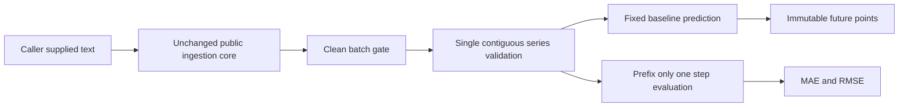

# Structure and rationale

The original application is not the source of this layout or record contract.
These are fresh neutral interfaces and common arithmetic, with explicit
first-party reuse of the already public MIT ingestion core.

1. **Pass the whole batch.** A valid row retained next to a rejection is useful
   for review, but not an accepted complete dataset. Both APIs call the clean
   gate rather than accepting a caller's accidental partial-record selection.
   Deliberately forging a clean batch is outside the trust boundary.
2. **Validate chronology explicitly.** One series and consecutive ordinal
   periods give each baseline a precise meaning. Missing periods and dates
   require an independently reviewed private mapping; no imputation is hidden.
3. **Keep three methods inspectable.** Last-value, fixed observed-window mean
   and repeated observed season have short, documented arithmetic. This is a
   comparison reference, not an extracted private forecasting policy.
4. **Control what a predictor sees.** Evaluation passes only earlier prefixes
   into `_predict`. Tests inspect every received prefix and independently alter
   future holdouts. The public API exposes no automatic tuning or winner.
5. **Use an explicit evaluation start.** Insufficient history raises an error.
   Silently changing the start would alter the holdout set and make a comparison
   misleading. Matching settings remain the caller's responsibility.
6. **Separate calculation and integration.** The core takes objects in memory;
   the CLI supplies only invented records. Data access, model assets, recipient
   selection, notifications, scheduling and persistence stay outside the module.

The ingestion snapshot keeps the tool runnable by itself without path discovery
or runtime dependency installation. CI checks its exact equality with the
collection's public core. A later upstream change requires an explicit snapshot
review; it is not fetched or updated at runtime.

Accepted input, future points and scores retain the sensitivity of their source.
Method names and fixed diagnostics do not anonymize them. Private adapters need
their own authorization, retention, integration and real-data validation.
