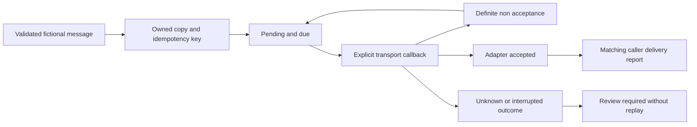

# Structure and design decisions

This is fresh generic source, not an export of an original service, template,
routing scheme, retry policy or operational record.

1. **Separate acceptance from delivery.** A valid receipt says only what the
   adapter asserts. A subsequent matching caller report is explicitly unverified;
   neither state is proof of real mailbox delivery.
2. **Treat uncertainty conservatively.** A provider may accept before a response
   is lost. Catching a generic exception and retrying would hide this ambiguity.
   Only an explicit definite-non-acceptance assertion enables automatic retry.
3. **Retain key identity across terminal states.** Re-enqueueing identical content
   does not replay it. Conflicting content cannot replace it. Capacity includes
   old keys, making the retention boundary visible rather than silently forgetting
   idempotency. It still ends when the instance is lost or restarted.
4. **Inject time and transport.** Integer ticks and scripted fake outcomes make
   dispatch deterministic. There is no wall-clock capture, sleep, provider setup,
   credential discovery or accidental email delivery in the demo.
5. **Keep diagnostics small.** Snapshots contain states, key, counters and fixed
   codes. Exception text, subject/body, route and receipt stay out. Actual keys
   and timing/count metadata can still be sensitive and must stay private.
6. **Expose limits rather than implying durability.** This is one synchronous
   caller and an in-memory state machine. Callback mutation is guarded, but
   concurrency, transactional persistence, provider reconciliation and crash
   recovery need their own separately reviewed implementations.

A later private integration can map a minimal authorized ingestion/forecast
result to a message and resolve symbolic routes. It must separately establish
message authorization, template/data handling, provider idempotency, safe failure
classification, delivery evidence, retention and recovery. No source mapping,
recipient, provider or business policy is selected by this reference.
