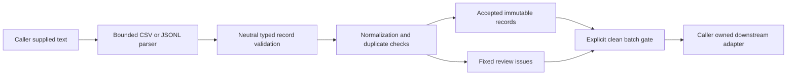

# Structure and design rationale

This first reference slice separates text parsing, neutral domain values,
normalization, duplicate decisions and the downstream review gate. It contains
no private source, business formulas, schemas, queries or operational metadata.

| Boundary | Responsibility |
| --- | --- |
| `ingest_csv` / `ingest_jsonl` | Bounded text parsing with format-specific numeric and syntax rules |
| `Point` / `_point` | One neutral shape with canonical IDs and finite bounded values |
| `_collect` | Stable ordering, identical duplicates, conflicts, issue positions and record/series limits |
| `Batch.require_clean` | Explicit refusal of partial or empty batches before downstream use |
| `demo.py` | Complete built-in fictional exercise; no operator file or service adapter |
| `tests/` | Independent format comparisons, boundary/refusal cases, canaries and actual CLI checks |

## Why these decisions

1. **One typed core, separate parsers.** CSV numeric strings and JSON numeric
   types have different rules. They normalize into the same immutable values,
   so a downstream consumer does not reinterpret file syntax.
2. **Review before consumption.** Accepted rows and fixed issues are separate.
   Retaining valid records helps inspection; the explicit clean gate prevents
   silently treating a partially rejected batch as complete.
3. **Conflicts stay visible.** Identical repeats are idempotent. Different
   values under the same key require review, with no last-write-wins policy.
4. **Normalize only declared neutral fields.** Canonical IDs and finite values
   are predictable. Units, dates and business meanings are never inferred or
   repaired from an unknown source.
5. **Keep diagnostics small.** Issue positions/codes omit raw values, unknown
   keys and native parser messages. Accepted records still require private
   handling; fixed diagnostics are not an anonymization promise.
6. **Keep integrations outside this slice.** The core takes in-memory text.
   Authorized database/file readers, source-specific mappings, rejected-payload
   retention, forecasting and email/outbox delivery belong to separate adapters
   or separately reviewed modules.

Future modules can consume a clean tuple without importing an ingestion source
adapter or knowing its credentials. Keep real mappings, queries, formulas,
source lineage, recipients, connection details, records and deployment setup
outside the public examples. This reference does not clear any historical
application or provide its private behavior.
